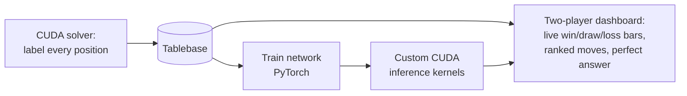

# Warpmate — CUDA Chess Endgame Solver

Warpmate is a GPU pipeline built around small chess endgames:

1. **Solve** every position of an endgame (say king + rook vs king) with CUDA, producing perfect win/draw/loss labels and the exact distance to mate.
2. **Train** a small neural network on that perfectly labeled data to predict who wins from any position.
3. **Run** the network with custom CUDA inference kernels, benchmarked against PyTorch and TensorRT.
4. **Play** on a two-player dashboard: two people share one board while live win/draw/loss bars update after every move, next to the perfect answer.

> 🚧 **Status:** early development. Features marked *planned* are not built yet.

## How it works

### Solving endgames (retrograde analysis)

The solver works backward from checkmate:

1. List every legal position for the chosen pieces.
2. Mark each checkmate as a loss for the side to move.
3. A position is a **win** if *any* move reaches a position lost for the opponent, and a **loss** if *every* move reaches a position won for the opponent.
4. Repeat until nothing changes. Every unmarked position is a **draw**.

Each round applies the same check to every position independently, which maps naturally onto the GPU: one CUDA thread per position, millions of positions per round.

### Learning from perfect data

Because the solver labels every position exactly, the network's accuracy can be measured against ground truth rather than estimated. During play, every legal next move is evaluated in a single batched GPU call, so the dashboard can rank moves and flag blunders in real time.



## Features

- **CPU reference solver** in C++ for king + rook vs king *(in progress)*
- **CUDA solver** with successive optimizations: a parallel sweep, backward move generation, and board-symmetry compression *(planned)*
- **Verification** of every position against the public Syzygy tablebases *(planned)*
- **Neural network** trained on solver output, with accuracy measured against perfect answers *(planned)*
- **Custom CUDA inference**: batched evaluation, fused layers, and 8-bit quantization, compared with PyTorch and TensorRT *(planned)*
- **Two-player dashboard** with live win/draw/loss bars, ranked next moves, and blunder warnings *(planned)*
- **Benchmarks** comparing single-threaded CPU, multithreaded CPU, and GPU versions *(planned)*

## Tech stack

| Area | Tools |
|---|---|
| Solver | C++17, CUDA |
| Build | CMake |
| Verification | Python, [python-chess](https://python-chess.readthedocs.io/) with Syzygy tablebases |
| Machine learning | Python, PyTorch |
| Inference | CUDA C++, compared with PyTorch and TensorRT |
| Profiling | NVIDIA Nsight Systems / Nsight Compute |
| Dashboard | HTML, CSS, JavaScript |

## Project structure

```
Warpmate/
├── README.md        Project overview (this file)
├── docs/            Technical documentation
└── ...              Solver, ML, and dashboard code (added as development progresses)
```

## Results

Benchmarks, verification, and model accuracy results will be published here once measured.
