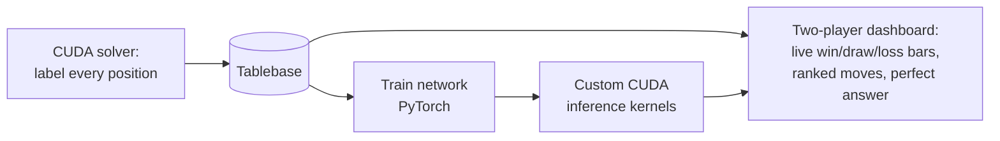

# Warpmate — CUDA Chess Endgame Solver

Warpmate is a GPU pipeline built around small chess endgames:

1. **Solve** every position of an endgame (say king + rook vs king) with CUDA, producing perfect win/draw/loss labels and the exact distance to mate.
2. **Train** a small neural network on that perfectly labeled data to predict who wins from any position.
3. **Run** the network with custom CUDA inference kernels, benchmarked against PyTorch and TensorRT.
4. **Play** on a two-player dashboard: two people share one board while live win/draw/loss bars update after every move, next to the perfect answer.

> 🚧 **Status:** early development. Features marked *planned* are not built yet.

## How it works

### Solving endgames (retrograde analysis)

The solver works backward from checkmate:

1. List every legal position for the chosen pieces.
2. Mark each checkmate as a loss for the side to move.
3. A position is a **win** if *any* move reaches a position lost for the opponent, and a **loss** if *every* move reaches a position won for the opponent.
4. Repeat until nothing changes. Every unmarked position is a **draw**.

Each round applies the same check to every position independently, which maps naturally onto the GPU: one CUDA thread per position, millions of positions per round.

### Learning from perfect data

Because the solver labels every position exactly, the network's accuracy can be measured against ground truth rather than estimated. During play, every legal next move is evaluated in a single batched GPU call, so the dashboard can rank moves and flag blunders in real time.



## Features

- **CPU reference solver** in C++ for king + rook vs king: solves all 524,288 positions and finds the known 16-move longest mate ✅
- **Probe tool** that looks up any position and prints the result, every move's outcome, and the line of perfect play ✅
- **CUDA solver** with successive optimizations: a parallel sweep, backward move generation, and board-symmetry compression *(planned)*
- **Verified against Syzygy**: all 399,112 legal KRvK positions match the official tablebases, with 0 mismatches ✅
- **Neural network** trained on solver output, with accuracy measured against perfect answers *(planned)*
- **Custom CUDA inference**: batched evaluation, fused layers, and 8-bit quantization, compared with PyTorch and TensorRT *(planned)*
- **Two-player dashboard** with live win/draw/loss bars, ranked next moves, and blunder warnings *(planned)*
- **Benchmarks** comparing single-threaded CPU, multithreaded CPU, and GPU versions *(planned)*

## Tech stack

| Area | Tools |
|---|---|
| Solver | C++17, CUDA |
| Build | CMake |
| Verification | Python, [python-chess](https://python-chess.readthedocs.io/) with Syzygy tablebases |
| Machine learning | Python, PyTorch |
| Inference | CUDA C++, compared with PyTorch and TensorRT |
| Profiling | NVIDIA Nsight Systems / Nsight Compute |
| Dashboard | HTML, CSS, JavaScript |

## Project structure

```
Warpmate/
├── CMakeLists.txt         Build configuration
├── src/
│   ├── core/              Board, attacks, KRvK positions and moves (CPU + GPU)
│   ├── solver/            Retrograde solver: per-position step + CPU driver
│   └── io/                Tablebase file format
├── tools/
│   ├── solve.cpp          warpmate-solve: build a table
│   └── probe.cpp          warpmate-probe: look up a position
├── tests/                 Unit and consistency tests
├── scripts/
│   └── verify_syzygy.py   Check a table against Syzygy
└── docs/                  Technical documentation
```

## Getting started

Requires CMake 3.20+ and a C++17 compiler.

```bash
cmake -S . -B build
cmake --build build
ctest --test-dir build          # run the tests

./build/warpmate-solve          # solve KRvK, writes tables/krvk.wmtb
./build/warpmate-probe "8/8/8/8/8/2k5/1R6/K7 w - - 0 1"
```

Example probe output (abridged):

```
Result: White mates in 16
Best move: Kb1
Perfect play: 1. Kb1 Kd4 2. Kc2 Kc4 3. Rb1 Kd4 ... 15. Kc7 Ka7 16. Ra1#
```

To verify against Syzygy, install the Python requirements and download `KRvK.rtbw` (see the instructions at the top of `scripts/verify_syzygy.py`), then:

```bash
pip install -r scripts/requirements.txt
python scripts/verify_syzygy.py --syzygy syzygy
```

See [docs/solver.md](docs/solver.md) for how the solver works.

## Results

**Correctness (KRvK, CPU solver):** every one of the 399,112 legal positions matches the Syzygy tablebases (0 mismatches), and the longest forced mate is 16 moves, the known value. See [docs/verification.md](docs/verification.md).

GPU benchmarks and model accuracy will be published here once measured.
