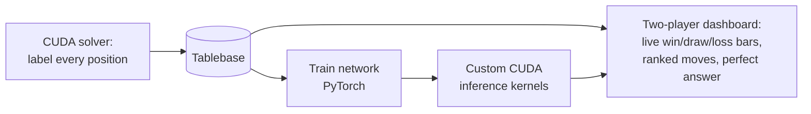

# Warpmate: CUDA Chess Endgame Solver

Warpmate is a GPU pipeline built around small chess endgames:

1. **Solve** every position of an endgame (say king + rook vs king) with CUDA, producing perfect win/draw/loss labels and the exact distance to mate.
2. **Train** a small neural network on that perfectly labeled data to predict who wins from any position.
3. **Run** the network with custom CUDA inference kernels, benchmarked against PyTorch and TensorRT.
4. **Play** on a two-player dashboard: two people share one board while live win/draw/loss bars update after every move, next to the perfect answer.

> **Status:** early development. Features marked *planned* are not built yet.

## How it works

### Solving endgames (retrograde analysis)

The solver works backward from checkmate:

1. List every legal position for the chosen pieces.
2. Mark each checkmate as a loss for the side to move.
3. A position is a **win** if *any* move reaches a position lost for the opponent, and a **loss** if *every* move reaches a position won for the opponent.
4. Repeat until nothing changes. Every unmarked position is a **draw**.

Each round applies the same check to every position independently, which maps naturally onto the GPU: one CUDA thread per position, millions of positions per round.

### Learning from perfect data

Because the solver labels every position exactly, the network's accuracy can be measured against ground truth rather than estimated. During play, every legal next move is evaluated in a single batched GPU call, so the dashboard can rank moves and flag blunders in real time.



## Features

- **CPU solver** in C++ (multithreaded), the reference the GPU is checked against. First case, king + rook vs king: solves all 524,288 positions and finds the known 16-move longest mate *(done)*
- **General solver** for any endgame of up to 4 pieces (all piece types, pawns and promotion), with linked tables for captures and promotions *(done)*
- **Probe tool** that looks up any position and prints the result, every move's outcome, and the line of perfect play *(done)*
- **CUDA solver** (v1: one GPU thread per position): produces a table byte-for-byte identical to the CPU's, about 66× faster than the best CPU result on the same machine (KRvK, measured with the first KRvK-only version) *(done)*
- **4-piece endgames on the GPU**, then faster CUDA versions with backward move generation and board-symmetry compression *(planned)*
- **Verified against Syzygy**: all 1,945,584 legal positions of the five 3-piece endgames match the official tablebases, with 0 mismatches *(done)*
- **Neural network** trained on solver output, with accuracy measured against perfect answers *(planned)*
- **Custom CUDA inference**: batched evaluation, fused layers, and 8-bit quantization, compared with PyTorch and TensorRT *(planned)*
- **Two-player dashboard** with live win/draw/loss bars, ranked next moves, and blunder warnings *(planned)*
- **Benchmarks** comparing single-threaded CPU, multithreaded CPU, and GPU, with Nsight profiling *(done)*

## Tech stack

| Area | Tools |
|---|---|
| Solver | C++17, CUDA |
| Build | CMake |
| Verification | Python, [python-chess](https://python-chess.readthedocs.io/) with Syzygy tablebases |
| Machine learning | Python, PyTorch |
| Inference | CUDA C++, compared with PyTorch and TensorRT |
| Profiling | NVIDIA Nsight Systems / Nsight Compute |
| Dashboard | HTML, CSS, JavaScript |

## Project structure

```
Warpmate/
├── CMakeLists.txt         Build configuration
├── src/
│   ├── core/              Bitboards, piece attacks and stored values (CPU + GPU)
│   ├── egtb/              Solver: positions, moves, per-position step, linked tables, CPU driver
│   ├── gpu/               CUDA solver: kernels and GPU memory management
│   └── io/                Tablebase file format
├── tools/
│   ├── gen.cpp            warpmate-gen: solve any endgame (and its dependencies)
│   ├── probe.cpp          warpmate-probe: look up any solved position
│   └── bench.cpp          warpmate-bench: time CPU vs GPU and check they agree
├── tests/                 Unit, consistency, and CPU-vs-GPU tests
├── examples/
│   └── cuda_basics/       Introductory CUDA programs
├── notebooks/             Colab notebook to build and run on a free GPU
├── scripts/
│   └── verify_syzygy.py   Check a table against Syzygy
└── docs/                  Technical documentation
```

## Getting started

Requires CMake 3.20+ and a C++17 compiler. GPU support is built automatically when the CUDA toolkit (`nvcc`) is found; without it, everything else still builds and runs on the CPU.

```bash
cmake -S . -B build
cmake --build build
ctest --test-dir build          # run the tests

./build/warpmate-gen --all3     # solve every 3-piece endgame into tables/
./build/warpmate-probe "8/8/8/8/8/2k5/1R6/K7 w - - 0 1"

./build/warpmate-gen --gpu KQvKR   # solve on the GPU (CUDA builds only)
./build/warpmate-bench KQvKR       # time CPU vs GPU
```

No NVIDIA GPU? Open [`notebooks/step6b_4piece_gpu.ipynb`](notebooks/step6b_4piece_gpu.ipynb) in Google Colab with a free T4 GPU.

Example probe output (abridged):

```
Result: White mates in 16
Best move: Kb1
Perfect play: 1. Kb1 Kd4 2. Kc2 Kc4 3. Rb1 Kd4 ... 15. Kc7 Ka7 16. Ra1#
```

Probing a king + pawn ending shows perfect play crossing into another table when the pawn promotes:

```
$ ./build/warpmate-probe "3k4/8/3K4/3P4/8/8/8/8 w - - 0 1"
Result: White mates in 11
Perfect play: 1. Ke6 Kc7 2. d6+ Kb6 3. d7 Kc7 4. Ke7 Kb6 5. d8=Q+ Kc5 ... 11. Qa2#
```

To verify against Syzygy, install the Python requirements and download the matching `.rtbw` files (see the instructions at the top of `scripts/verify_syzygy.py`), then:

```bash
pip install -r scripts/requirements.txt
python scripts/verify_syzygy.py --syzygy syzygy tables/*.wmtb
```

See [docs/solver.md](docs/solver.md) for how the solver works.

## Results

**Correctness:** all five 3-piece endgames (KQvK, KRvK, KBvK, KNvK, KPvK) match the Syzygy tablebases on every one of 1,945,584 legal positions, with 0 mismatches. Longest forced mates match known values (KQvK 10 moves, KRvK 16). See [docs/verification.md](docs/verification.md).

**Speed (KRvK, Colab Tesla T4):**

| Solver | Median time | Speedup vs 1 CPU thread |
|---|---|---|
| CPU, 1 thread | 616 ms | 1.0× |
| CPU, 2 threads | 536 ms | 1.1× |
| **GPU v1** | **8.1 ms** | **76×** |

The GPU table is byte-for-byte identical to the CPU table. Colab's CPU is weak (2 threads on one core), so the gap would be smaller against a strong multi-core CPU; see [docs/benchmarks.md](docs/benchmarks.md) for methodology, caveats, and the Nsight profile.

Model accuracy will be published here once measured.
