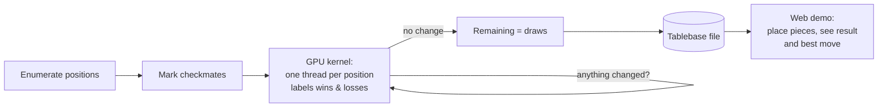

# Warpmate — CUDA Chess Endgame Solver

Warpmate computes **perfect play for small chess endgames** on the GPU. Give it a set of pieces (say king + rook vs king) and it works out, for every possible arrangement of those pieces, who wins with best play, in how many moves, and the best move. The results are stored in a lookup table (an *endgame tablebase*) and explored through an interactive web demo.

> 🚧 **Status:** early development. Sections marked *planned* describe work in progress.

## How it works

The solver uses **retrograde analysis**, working backward from checkmate:

1. List every legal position for the chosen pieces.
2. Mark each checkmate as a loss for the side to move.
3. A position is a **win** if *any* move reaches a position lost for the opponent, and a **loss** if *every* move reaches a position won for the opponent.
4. Repeat until nothing changes. Every unmarked position is a **draw**.

Each round applies the same check to every position independently, which maps naturally onto the GPU: one CUDA thread per position, millions of positions per round.



## Features

- **CPU reference solver** in C++, used to check the GPU results *(planned)*
- **CUDA solver** with successive optimizations: a parallel sweep, backward move generation, and board-symmetry compression *(planned)*
- **Verification** of every position against the public Syzygy tablebases *(planned)*
- **Interactive demo**: drag pieces onto a board to see the result and best move, play against perfect defense, and view position heatmaps *(planned)*
- **Benchmarks** comparing single-threaded CPU, multithreaded CPU, and GPU versions *(planned)*

## Tech stack

| Area | Tools |
|---|---|
| Solver | C++17, CUDA |
| Build | CMake |
| Verification | Python, [python-chess](https://python-chess.readthedocs.io/) with Syzygy tablebases |
| Profiling | NVIDIA Nsight Systems / Nsight Compute |
| Demo | HTML, CSS, JavaScript (static site) |

## Project structure

```
Warpmate/
├── README.md        Project overview (this file)
├── docs/            Technical documentation
└── ...              Solver, verification, and demo code (added as development progresses)
```

## Results

Benchmarks and verification results will be published here once measured.
